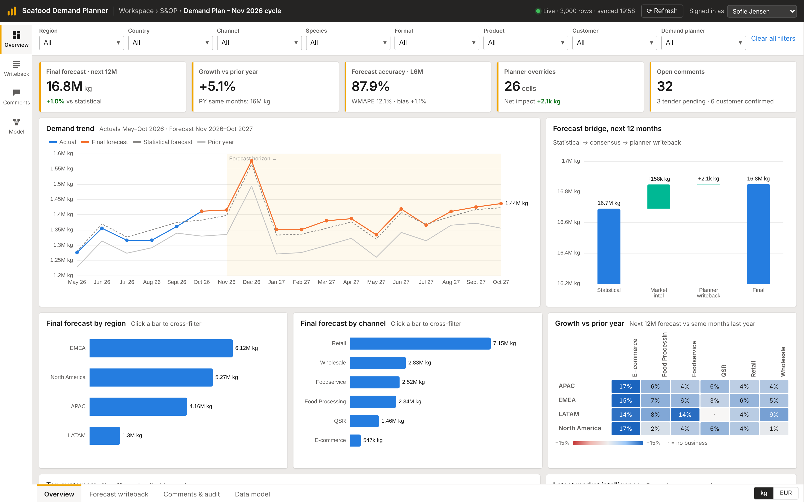
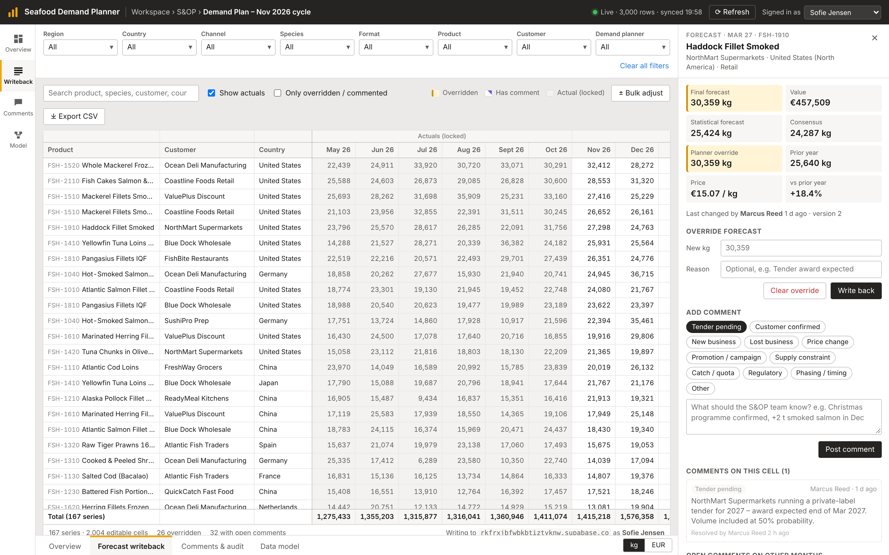
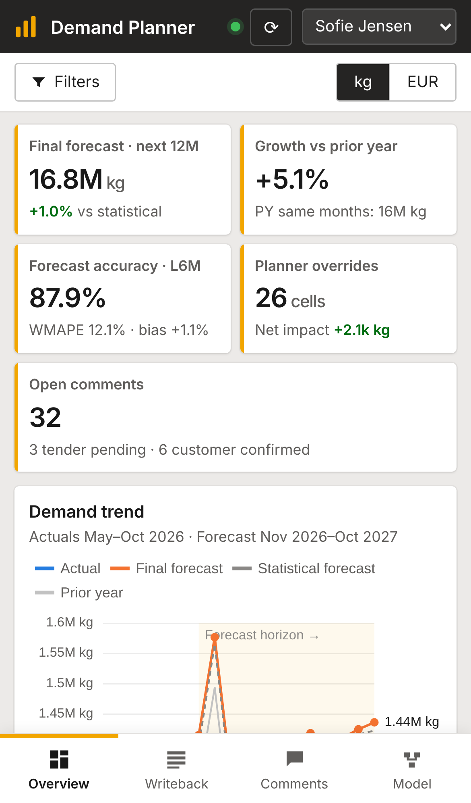
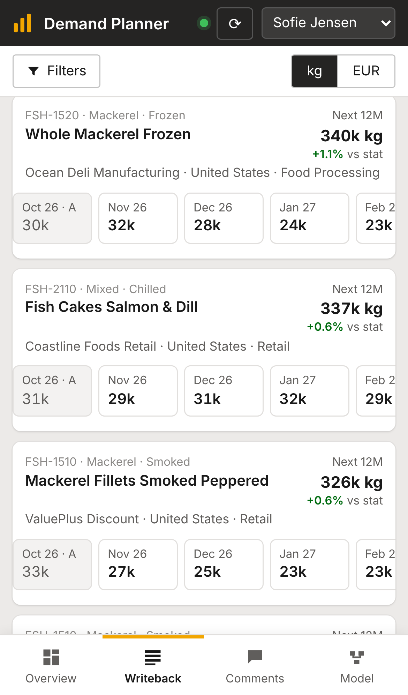

# Seafood Demand Planner: BI dashboard with writeback

A Power BI-style S&OP demand-planning report for a seafood company selling fish products. Planners can **write back** forecast overrides and business comments (such as *Tender pending* or *Customer confirmed*) into a live Postgres database on Supabase.




<p>


</p>

## What it shows

| Page | What's on it |
|---|---|
| **Overview** | KPI cards (12-month final forecast, growth vs prior year, forecast accuracy/bias, overrides, open comments), demand trend (actuals, statistical forecast, final forecast, prior year), forecast bridge (statistical → consensus → writeback), cross-filtering region and channel bars, a growth heat-matrix, top customers, latest comments |
| **Forecast writeback** | An Excel-like matrix (Product × Customer × Country by month). Actual months are locked; forecast months are editable. Overridden cells are highlighted and cells with comments are flagged. Also has bulk % adjustment and CSV export |
| **Detail pane** | Statistical, consensus, override and final values, value in EUR, prior year, price; override with reason; categorised comments; per-cell change history |
| **Comments & audit** | Open comments by category, a comment feed (open/resolved) and the full audit trail. Click any item to jump to its cell |
| **Data model** | How the writeback architecture works, for the data team |

Slicers: Region, Country, Channel, Species, Format, Product, Customer, Demand planner. You can switch every measure between **kg** and **EUR**.

### Mobile

Below 860px wide, the same app switches to a phone layout that scrolls like an app:
- Compact top bar, with a sticky **Filters** button (showing how many filters are active) and the kg/EUR toggle
- Filters open as a **bottom sheet** with large tap targets
- A **fixed bottom tab bar** for Overview, Writeback, Comments and Model
- Writeback becomes **cards**, one per product, customer and country. Each card has a swipeable strip of months; actuals are greyed, overrides highlighted and comments flagged. Tap a month to open a **full-screen sheet** where you can override, comment and see the history. Cards load 20 at a time ("Show more")
- Wide tables and the growth matrix scroll sideways inside their cards. The page itself never scrolls sideways

## Sample data (fictional)

`data/demand_plan.csv`: **3,000 rows**, produced by `scripts/generate_data.py` (seeded, so it can be reproduced).

- **Grain:** Product × Customer × Country × Month, 167 series
- **Horizon:** 6 months of actuals (May–Oct 2026) + 12 months of forecast (Nov 2026–Oct 2027). One new-product launch has only forecast months.
- **24 seafood products** across 11 species: salmon, cod, pollock, shrimp, tuna, mackerel, herring, trout, pangasius, haddock and mixed seafood
- **6 formats:** Fresh, Frozen, Smoked, Chilled, Canned, Salted
- **6 sales channels:** Retail, Foodservice, Wholesale, Food Processing, QSR (quick-service restaurants), E-commerce
- **4 regions, 19 countries**, with region-level pricing, channel growth trends and seafood seasonality: smoked salmon peaks at Christmas, cod and bacalao at Christmas and Lent/Easter, herring at Midsummer and Christmas, shrimp in summer (offset in the southern hemisphere), and pollock comfort food in winter
- **Writeback comment categories:** Tender pending, Customer confirmed, New business, Lost business, Price change, Promotion / campaign, Supply constraint, Catch / quota, Regulatory, Phasing / timing, Other
- **Measures:** `actual_kg`, `stat_forecast_kg`, `consensus_kg`, `override_kg` (the writeback), `prior_year_kg`, `price_eur_per_kg`

All customer and product names are made up.

## Backend (Supabase)

Schema: `supabase/migrations/001_seafood_schema.sql`

```
demand_plan   – fact table (3,000 rows: product, species, format, channel, customer, country, month); final forecast = coalesce(override_kg, consensus_kg)
plan_comment  – categorised comments per plan cell (Open / Resolved)
plan_audit    – append-only log of every override, bulk change, comment and resolution
v_demand_plan – reporting view with EUR measures, for Power BI / Excel / SQL users
```

**Security model:** row-level security makes the tables **read-only** for the API. Every write goes through validated `SECURITY DEFINER` functions:

| Function | Behaviour |
|---|---|
| `writeback_forecast(id, kg, user, expected_version, note)` | Rejects locked actual periods and out-of-range values. Uses **optimistic concurrency**, so two planners editing the same cell get a conflict instead of overwriting each other |
| `writeback_bulk_pct(ids[], pct, user, note)` | Applies a % change to many cells in one transaction |
| `add_plan_comment(id, category, body, user)` | Adds a comment and an audit entry |
| `resolve_plan_comment(comment_id, user)` | Closes a comment |

The client polls `plan_audit` every 15 seconds, so one planner's changes appear for everyone else viewing the report.

> **Demo vs production:** in the demo the user is picked from the "Signed in as" menu. For production, turn on Supabase Auth (Azure AD / SSO), take the user from `auth.uid()` inside the functions, and grant `EXECUTE` to `authenticated` only.

## Run it

No build step; it's a static site (ECharts is bundled in `app/vendor`).

```bash
cd app
python3 -m http.server 8080
# open http://localhost:8080
```

Connection settings are in `app/config.js`. The publishable key is safe to ship to browsers because RLS only allows reads.

## Connect Power BI / Excel to the same data

Use the Postgres connector with the Supabase connection string (Project settings → Database) and read `public.v_demand_plan`. Writebacks from this app appear on the next refresh.
